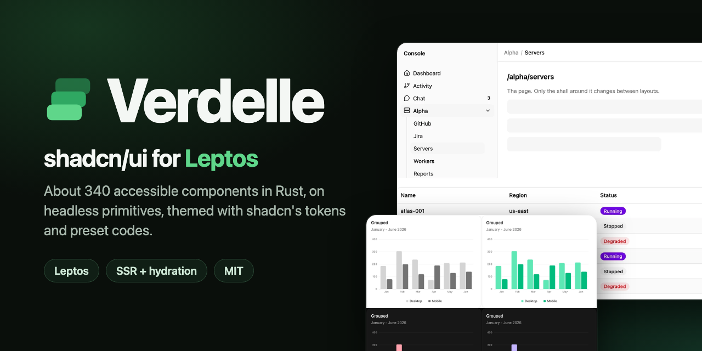
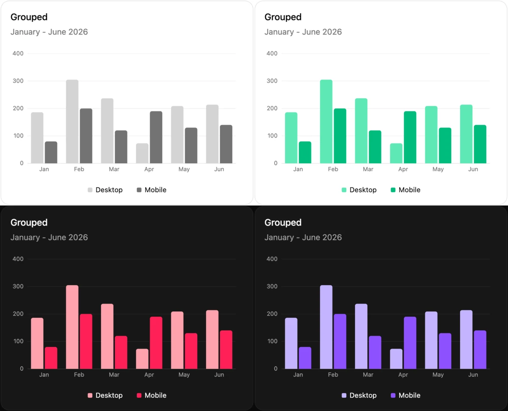
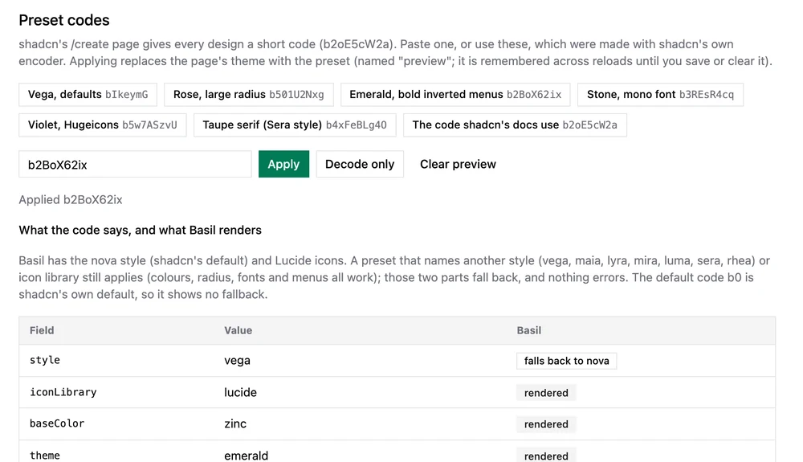
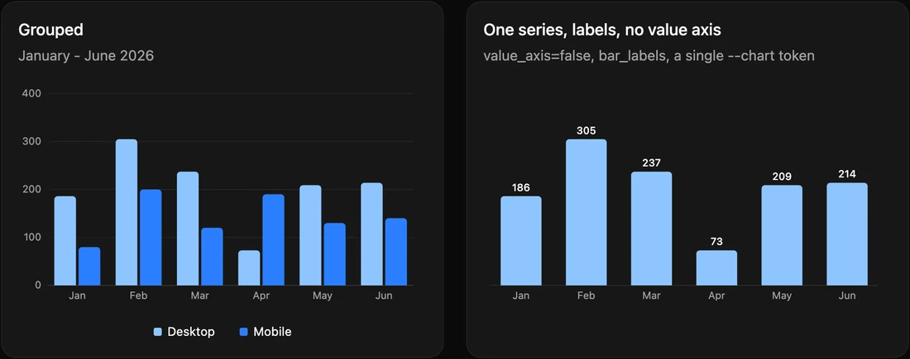

<p align="center">
  
</p>

> **Status: early; `0.8.0` is on crates.io.** Targets Leptos 0.8 only, supports shadcn's **nova** style only, and has been tested in Chromium
> (desktop, light and dark), not yet on real devices. The API may still change between releases (see below). Verdelle is an unofficial port and is not affiliated with shadcn/ui, Base UI, Radix or Leptos.

## What it is

- **shadcn's design, in Rust.** Components follow shadcn's nova style (sizes, states, names) and use shadcn's CSS tokens
  (`--background`, `--primary`, `--ring`, ...). A theme exported from [ui.shadcn.com/create](https://ui.shadcn.com/create)
  pastes in as CSS, and a preset code (`b2oE5cW2a`) pastes in as a string.
- **Typed props, plain CSS.** A component takes `variant`, `size` and so on, and emits `data-*` attributes that the CSS
  styles. No class strings are built from props. Tailwind is optional; if you use it, utility classes passed through a
  component's `class` prop override Verdelle's styles, as in shadcn.
- **Headless primitives underneath.** Roles, keyboard handling, focus, ids and positioning live in `verdelle_ui::primitives`,
  ported from [Leptix](https://github.com/RantAI-dev/leptix-ui) (itself a port of Radix) and moving toward Base UI's API.
  You can use them without the styled layer.
- **SSR and hydration** work (cargo-leptos). Browser-only code is gated on the `hydrate` feature.

It covers shadcn's base registry except Direction (RTL is out of scope) and the eight chat components added there lately
(Message, Bubble, Attachment, ...; planned for `verdelle-ui`), plus a few extras (Data Table, App shells,
PageHeader, StatCard, Time Input, Number Field, ...). How each component's API compares with shadcn's is in
[docs/api-coverage.md](docs/api-coverage.md).



## Quick start

About ten minutes with a fresh Leptos SSR app. This is the path that was built and run to check these steps.

**1. Create an app.** Use the Leptos [start-axum](https://github.com/leptos-rs/start-axum) template (stable Rust is
enough; answer "No" to nightly):

```sh
cargo install cargo-leptos --locked
cargo leptos new --git https://github.com/leptos-rs/start-axum
```

**2. Add Verdelle and forward its features** in `Cargo.toml`:

```toml
[dependencies]
verdelle-ui = "0.8"   # Leptos 0.8. Unreleased: { git = "https://github.com/j-fulbright/verdelle-ui", rev = "<commit>" }

[features]
hydrate = ["leptos/hydrate", "verdelle-ui/hydrate", "dep:console_error_panic_hook", "dep:wasm-bindgen"]
ssr = ["verdelle-ui/ssr", "dep:axum", "dep:tokio", "dep:leptos_axum", "leptos/ssr",
       "leptos_meta/ssr", "leptos_router/ssr"]
```

The `ssr` feature matters: without it the theme storage panics on the server.

**3. Serve Verdelle's CSS.** Verdelle's styles are embedded in the crate: `verdelle_ui::kit_css()` returns them as one string (theme
tokens and component styles, with the CSS layer order stated first, so your Tailwind utilities still override them). Serve it
from the axum router in `src/main.rs`, before `.leptos_routes(...)`; this works the same for path, git and registry
dependencies and needs no `build.rs` and no file copying:

```rust
use axum::{http::header, routing::get};

// let app = Router::new()
    .route("/verdelle.css", get(|| async {
        ([(header::CONTENT_TYPE, "text/css; charset=utf-8"),
          (header::CACHE_CONTROL, "no-cache")],
         verdelle_ui::kit_css())
    }))
```

and link it in the `<head>` of your `shell()`: `<link rel="stylesheet" href="/verdelle.css" />`. (`docs/new-app.md` hashes the content
into the URL so it can be cached for a year.)

*With Tailwind v4* (what cargo-leptos runs for `tailwind-input-file`), the app's Tailwind input holds only your own
utilities, with no Verdelle import:

```css
/* style/tailwind.css */
@import "tailwindcss";
@source "../src/**/*.rs";
@variant dark (&:where(.dark, .dark *));

/* optional: bg-background, text-muted-foreground, ... Copy the @theme inline block of crates/verdelle-ui/css/tailwind.css here. */

@layer base {
  *, ::before, ::after { border-color: var(--border); }   /* Tailwind v4's `border` defaults to currentColor */
}
body { background-color: var(--background); color: var(--foreground); margin: 0; }
```

In `Cargo.toml`, replace the template's `style-file` line with `tailwind-input-file = "style/tailwind.css"`.
Do not import Verdelle's `css/kit.css` from that file through a `build.rs` copy: cargo-leptos starts Tailwind before the app's
build script runs, so a clean build fails once. The reasons, the alternatives and a CI-safe variant are in
[docs/using-verdelle.md](docs/using-verdelle.md) and [docs/new-app.md](docs/new-app.md), which also has a complete working app layout.

*Without Tailwind*, skip the Tailwind input and set the page basics yourself in a `<style>` (Verdelle styles components, not the
page; without Tailwind's preflight the browser default is a serif font):

```rust
<style>"body { margin: 0; font-family: system-ui, sans-serif; background: var(--background); color: var(--foreground); }"</style>
```

*Known local issue:* on one Mac the Tailwind v4.1.17 binary that cargo-leptos downloads by default was killed (SIGKILL);
`LEPTOS_TAILWIND_VERSION=v4.1.13 cargo leptos watch` works.

**4. Use it.** Provide Verdelle's context once, wrap the app in `ThemeProvider`, and render components:

```rust
use verdelle_ui::{
    Button, ButtonVariant, Card, CardContent, CardDescription, CardHeader, CardTitle, Dialog,
    DialogDescription, DialogFooter, DialogHeader, DialogTitle, ModeToggle, ThemeMode,
    ThemeProvider, ThemeSwitcher, theme_init_script,
};
use leptos::prelude::*;

// In your shell(): apply the stored theme before first paint (no flash).
// <head> ... <script inner_html=theme_init_script(verdelle_ui::themes::DEFAULT_THEME, ThemeMode::System, (None, None))></script>

#[component]
pub fn App() -> impl IntoView {
    provide_meta_context();
    verdelle_ui::provide_ui_context();   // once, so each server request gets its own id counter

    view! {
        <Stylesheet id="leptos" href="/pkg/my-app.css" />
        <ThemeProvider script=false>   // false: the shell already printed the init script
            <HomePage />
        </ThemeProvider>
    }
}

#[component]
fn HomePage() -> impl IntoView {
    let open = RwSignal::new(false);
    view! {
        <main class="mx-auto max-w-md space-y-4 p-6">
            <div class="flex gap-2"><ThemeSwitcher /><ModeToggle /></div>
            <Card>
                <CardHeader>
                    <CardTitle>"Hello, Verdelle"</CardTitle>
                    <CardDescription>"shadcn/ui components, in Leptos."</CardDescription>
                </CardHeader>
                <CardContent>
                    <Button on_click=move |_| open.set(true)>"Open dialog"</Button>
                </CardContent>
            </Card>
            <Dialog open=open label="Hello">
                <DialogHeader>
                    <DialogTitle>"It works"</DialogTitle>
                    <DialogDescription>"A native dialog with a focus trap."</DialogDescription>
                </DialogHeader>
                <DialogFooter>
                    <Button variant=ButtonVariant::Outline on_click=move |_| open.set(false)>"Close"</Button>
                </DialogFooter>
            </Dialog>
        </main>
    }
}
```

Run `cargo leptos watch`. Click "Open dialog", pick another theme in the switcher, toggle dark mode.

Notes: `ThemeProvider` should sit above any `ThemeSwitcher` or `ModeToggle`. If you would rather not print the init
script yourself, leave `script` at its default (`true`) and the provider prints it. For a large app, `cargo leptos` sets
`--cfg erase_components` in dev; plain `cargo check`/`clippy` need it in `.cargo/config.toml` or `target/` grows very large.
Verdelle needs Rust 1.88 or newer.

## Theming and presets

A theme is shadcn's token set: a `:root` block for light, a `.dark` block for dark. Theme and light/dark mode are
independent (`data-theme` on `<html>`, `.dark` class). `ThemeProvider` owns both, remembers the choice in
`localStorage` and applies it before first paint. Verdelle ships shadcn's current 24 themes; design your own on
[ui.shadcn.com/create](https://ui.shadcn.com/create) (Verdelle has no editor of its own) and bring it in:

```rust
// A preset code from /create (decoded in Rust; colours, radius, fonts, menu colour and accent apply):
<ThemeProvider preset="b2oE5cW2a" default_mode=ThemeMode::System> ... </ThemeProvider>

// Or pasted shadcn CSS (the :root and .dark blocks), listed in ThemeSwitcher with the built-in themes:
<ThemeStyle name="ocean" css=include_str!("ocean.css") />
```

```rust
let p = verdelle_ui::preset::Preset::decode("b2oE5cW2a")?;
p.tokens();            // final light and dark token sets
p.google_fonts_url();  // fonts are yours to load; Verdelle bundles none
p.unsupported();       // which parts fell back to nova / Lucide
```

People can also save presets and pasted CSS under a name in their own browser (`use_theme()`: `try_preset`, `save_theme`,
`export_themes`, `import_themes`), and `ThemeSwitcher` lists them. Menu colour (for example inverted or translucent) and menu
accent (for example bold) from a preset restyle menus, selects and comboboxes. The storage is a trait if you want it elsewhere.



Only the **nova** style and **Lucide** icons exist. A preset that names another style (vega, maia, lyra, mira, luma, sera,
rhea) or icon library still applies its colours, radius, fonts and menus; the style and icons fall back to nova and Lucide,
and nothing errors. Details, the token composition rules and the storage API: [docs/presets-and-themes.md](docs/presets-and-themes.md).

## Components

All from `verdelle_ui` (one file per component; the names follow shadcn's, extras are listed in
[crates/verdelle-ui/NAMING.md](crates/verdelle-ui/NAMING.md)):

- **Basics and layout**: Button, Badge, Indicator, Card, Alert, Separator, Spinner, Skeleton, Avatar, Progress, Meter,
  Table, Data Table, Tabs, Accordion, Collapsible, Scroll Area, Aspect Ratio, Resizable, Carousel, Chart (bar, line, area,
  pie, radial, radar), Typography, Kbd, Empty, Item, Breadcrumb, Pagination, Icon (240 Lucide icons), PageHeader, StatCard, Toolbar.
- **Forms**: Input, Textarea, Label, Field family, Checkbox, Switch, Radio Group, Toggle, Toggle Group, Slider, Input OTP,
  Number Field, Time Input, Password Input, Select, Native Select, Combobox, Command, Input Group, Button Group, Calendar, Date Picker,
  Date Range Picker.
- **Overlays**: Dialog, Alert Dialog, Sheet, Drawer, Popover, Tooltip, Hover Card, Dropdown Menu, Context Menu, Menubar,
  Navigation Menu, Toast (`Toaster`, `use_toaster()`), Command dialog.
- **App frame**: Sidebar and `AppShell` (a plain-data menu drawn as a sidebar or a top bar).
- **Theming**: `ThemeProvider`, `ThemeStyle`, `ThemeSwitcher`, `ThemePicker`, `ModeToggle`, 24 built-in themes, preset codes.

### The gallery

`examples/gallery` is a storybook-style app (54 pages) that renders every component and every option, light and dark,
with a theme switcher. It is the live reference and how options are checked. No database or cloud setup:

```sh
git clone https://github.com/j-fulbright/verdelle-ui && cd verdelle-ui
cargo install cargo-leptos --locked
cargo leptos watch        # http://127.0.0.1:3100
```

`wasm-bindgen-cli` must match the `wasm-bindgen` version in `Cargo.lock` (`cargo install wasm-bindgen-cli --version <version> --locked`).



API docs: `cargo doc -p verdelle-ui --no-deps --open`.

## Accessibility and mobile

What is true today, no more:

- The primitives set ARIA roles and properties, support the keyboard patterns shadcn/Radix users expect (arrow keys, Home/End,
  typeahead in menus and lists, Escape, roving focus) and manage focus (traps, return on close). Dialog, Alert Dialog,
  Sheet and Drawer are native `<dialog>` elements, so the browser provides the focus trap, Escape and an inert page behind.
- Overlays animate out; `prefers-reduced-motion` turns overlay animation off, and `data-vdl-motion="off"` on `<html>`
  turns off every animation.
- Charts are one tab stop with arrow-key navigation, a live region and a hidden data table.
- Components are written to be responsive (the sidebar and top-bar shells collapse to a sheet or a menu on narrow screens),
  and the gallery is being fixed for narrow viewports.
- **Not verified:** nothing has had a real-device check (touch, iOS Safari, Android) or a screen reader pass. Behaviour was
  checked in Chromium with Playwright. Touch and screen-reader support should be treated as untested.

## Compatibility and versioning

- **Leptos 0.8 = Verdelle 0.8.x; Leptos 0.9 will be Verdelle 0.9.x.** A component library cannot span Leptos versions, because
  Leptos types are in its public API. The patch number is Verdelle's own.
- Stable Rust 1.88 or newer; no nightly features. wasm32 (hydrate) and native (ssr) both build.
- Tailwind is optional (v4 syntax shown above). Without it, use the embedded CSS.
- Only the nova style and Lucide icons; no RTL.
- Releases are git tags (`v0.8.0`) and crates.io versions; consume a release, not a branch.

## Status and roadmap

Every shadcn base component except Direction and the chat set is built and browser-checked in the gallery; per-component
API differences from shadcn are listed in [docs/api-coverage.md](docs/api-coverage.md). Next: moving a first real application onto Verdelle, a documentation page per component,
and later the chat and AI components, a preset-builder example, and other styles or icon
sets only if there is demand.

**Known limitations** (the short list; the full API comparison is in [docs/api-coverage.md](docs/api-coverage.md)): no real-device or screen-reader testing; nova and
Lucide only; fonts are not bundled; the chat components (Message, Bubble, ...) and Direction are not built; a few
components have narrower APIs than shadcn's (for example Slider has no hidden form input, Toasts have no stacked view or
promise helper, Carousel has no plugins, Tabs has no `orientation` or `line` variant, Select has no `multiple`, Dialog has
no `DialogClose`, Data Table has no column resizing or virtualisation); Leptos 0.9 is blocked on helper crates still
pinned to 0.8. The component-by-component list is [docs/api-coverage.md](docs/api-coverage.md).

## Contributing

```sh
./scripts/check.sh                                   # fmt, clippy (native, wasm, gallery) with -D warnings, tests, themegen --check
cargo test --workspace
cargo run -p verdelle-ui --example themegen             # regenerate tokens.css and themes.rs after changing themes/
```

`.cargo/config.toml` sets `--cfg erase_components`; keep it. Conventions (one component per file, `vdl-` CSS prefix, follow
shadcn's source rather than memory, every option gets a gallery example) are in [CLAUDE.md](CLAUDE.md).

## Docs

| | |
|---|---|
| [docs/presets-and-themes.md](docs/presets-and-themes.md) | Preset codes, pasted CSS, `ThemeProvider`, saved themes |
| [docs/using-verdelle.md](docs/using-verdelle.md) | Dependencies, features, the CSS options, versioning |
| [docs/api-coverage.md](docs/api-coverage.md) | Each shadcn component against Verdelle's API: full, partial, different or missing |
| [docs/new-app.md](docs/new-app.md) | Step-by-step recipe for a new app on Verdelle (Axum, cargo-leptos, Tailwind, CI) |
| [docs/reporting-issues.md](docs/reporting-issues.md) | Reporting problems from an app (what is safe to put in a public issue, a block for an app's agent notes) |
| [crates/verdelle-ui/NAMING.md](crates/verdelle-ui/NAMING.md) | Where names differ from shadcn's |

## Licence and credits

Verdelle is MIT licensed (`LICENSE`); the `verdelle-ui` crate is `MIT AND Apache-2.0 AND ISC` because of the last two items.
Notices are kept in `crates/verdelle-ui/NOTICE` and `LICENSES/`.

- **shadcn/ui** (MIT): the design, tokens, sizes and default theme.
- **Leptix** (MIT, Rantai Dev) and **Radix UI** (MIT, WorkOS): the primitives' behaviour.
- **Base UI** (MIT, MUI): the direction of the primitives' API.
- **gpui-component** (Apache-2.0): the `Indicator` component.
- **Lucide** (ISC): the icon set.

## AI disclosure

Verdelle was built with AI assistance (Claude Code, from Anthropic): most of the code, CSS, tests and docs were written by AI
under the maintainer's direction, and the maintainer has reviewed and directed the work, along with automated tests and browser
checks (see [Status and roadmap](#status-and-roadmap)). That is not a line-by-line audit or a security review. Treat it as
early software and please report problems.
