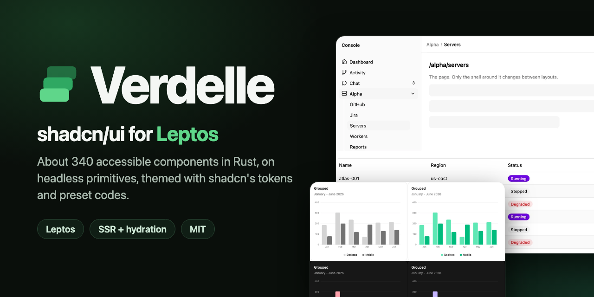
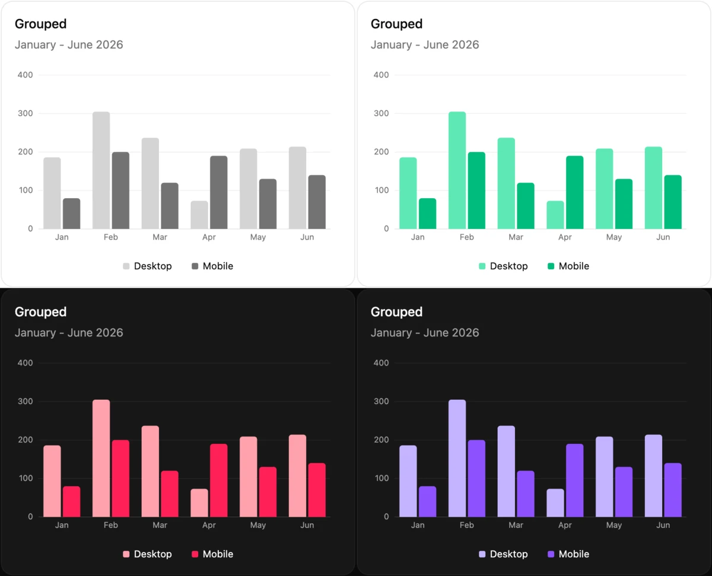

<p align="center">
  
</p>

shadcn/ui for [Leptos](https://leptos.dev) 0.8: about 340 styled, accessible components in plain CSS (Tailwind optional),
on headless primitives (`verdelle_ui::primitives`), themed with shadcn's tokens, theme CSS and preset codes.



> Early and in active development; the API will change. Leptos 0.8 only, shadcn's **nova** style only (presets that name
> another style fall back to nova), tested in Chromium, not yet on real devices. Not affiliated with shadcn/ui, Base UI,
> Radix or Leptos.

## Use it

```toml
[dependencies]
verdelle-ui = "0.8.0-alpha.1"   # a pre-release; "0.8" will match once 0.8.0 is out

[features]
hydrate = ["leptos/hydrate", "verdelle-ui/hydrate"]
ssr = ["leptos/ssr", "verdelle-ui/ssr"]
```

CSS: the stylesheets are embedded in the crate. Serve `verdelle_ui::kit_css()` (tokens and component styles in Tailwind's
`components` layer, layer order stated first) from your server and link it; this works the same for path, repository and
registry dependencies. `verdelle_ui::themes::TOKENS_CSS` and `verdelle_ui::COMPONENTS_CSS` are its two halves, for a `<style>`.
The files are also in the crate's `css/` folder (`kit.css`, `tokens.css`, `components.css`, and an optional `tailwind.css`
colour mapping for Tailwind v4), and an app's `build.rs` can find that folder through `DEP_VERDELLE_UI_CSS_DIR`, but copying
it breaks the first `cargo leptos build` on a clean checkout. The full recipe is in the repository's `docs/new-app.md`.

```rust
use verdelle_ui::{Button, Card, CardContent, CardHeader, CardTitle, ThemeProvider};

#[component]
fn App() -> impl IntoView {
    verdelle_ui::provide_ui_context();   // once, near the root
    view! {
        <ThemeProvider preset="b2oE5cW2a">   // a shadcn preset code (optional)
            <Card>
                <CardHeader><CardTitle>"Hello"</CardTitle></CardHeader>
                <CardContent><Button>"Click"</Button></CardContent>
            </Card>
        </ThemeProvider>
    }
}
```

The full walkthrough (a working app from a template, with and without Tailwind), theming, the component list, the
accessibility notes and the known limitations are in the
[repository README](https://github.com/j-fulbright/verdelle-ui#readme). More:
[presets and themes](https://github.com/j-fulbright/verdelle-ui/blob/main/docs/presets-and-themes.md),
[using Verdelle: dependencies and CSS options](https://github.com/j-fulbright/verdelle-ui/blob/main/docs/using-verdelle.md),
[API coverage against shadcn](https://github.com/j-fulbright/verdelle-ui/blob/main/docs/api-coverage.md),
[naming differences from shadcn](https://github.com/j-fulbright/verdelle-ui/blob/main/crates/verdelle-ui/NAMING.md).
Every component and option has an example in the gallery (`cargo leptos watch` in a checkout).

Verdelle's minor version equals Leptos's: `0.8.x` targets Leptos 0.8.

Licensed `MIT AND Apache-2.0 AND ISC`: see `LICENSE`, `NOTICE` and `LICENSES/` (shadcn/ui, Leptix, Radix, gpui-component, Lucide).

## AI disclosure

Built with AI assistance (Claude Code, from Anthropic): most of the code, CSS, tests and docs were written by AI under the
maintainer's direction, and the maintainer has reviewed and directed the work, along with automated tests and browser checks.
That is not a line-by-line audit or a security review; treat it as early software and report problems.
